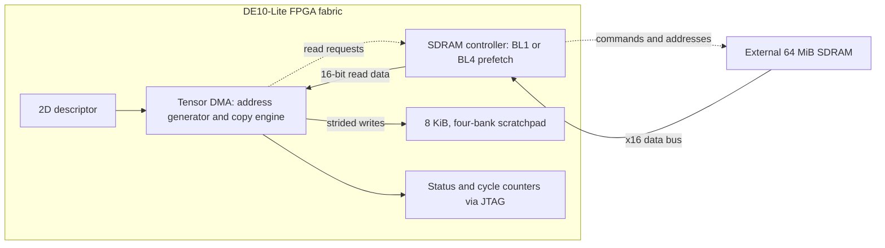

# Tensor Memory Accelerator

[](https://github.com/felixchen2007/tensor-memory-accelerator/actions/workflows/checks.yml)

**17.9 MB/s of effective tile bandwidth on a DE10-Lite FPGA.** Pipelining
and four-word SDRAM read prefetch moved a 32×32, 16-bit transpose in
**114.7 µs at 50 MHz**, a **2.88× speedup** over the serialized, single-word
baseline.

The SystemVerilog design combines a descriptor-driven tensor DMA engine, a
custom SDRAM controller, and an 8 KiB banked scratchpad. The engine uses
independent source and destination strides for copies and transposes.

[Board benchmark](docs/hardware_benchmark.md) ·
[Architecture](docs/architecture.md) ·
[Verification results](#verification) ·
[Run it locally](docs/reproduce.md)

## Hardware result

All three builds ran the same 2,048-byte transpose with the same clock, layout,
data pattern, and starting refresh phase. Each passed two fresh FPGA loads
and full tile readback on **2026-10-29 UTC**.

| Implementation | Cycles | Tile latency | Effective bandwidth | Speedup | Fitted logic elements |
| --- | ---: | ---: | ---: | ---: | ---: |
| Serialized, single-word reads (BL1) | 16,525 | 330.50 µs | 6.20 MB/s | 1.00× | 2,477 |
| Pipelined, single-word reads (BL1) | 13,541 | 270.82 µs | 7.56 MB/s | 1.22× | 2,703 |
| Pipelined, four-word prefetch (BL4) | **5,735** | **114.70 µs** | **17.86 MB/s** | **2.88×** | 2,856 |

Effective bandwidth divides useful tile bytes by the measured descriptor time.
The counter starts after initialization and seeding and stops before readback.
Logic counts include the board self-test and diagnostics.
[Six hardware runs and image hashes](evidence/hardware/2026-10-29/results.json)

Pipelining overlaps SDRAM reads with scratchpad writes and delivers a **1.22×**
gain at BL1. Four-word prefetch then delivers a further **2.36×** over
pipelined BL1 by reusing adjacent words from one SDRAM access. On the simulated
sparse column gather, BL4 took **23% more cycles** because it fetched four
times as much data. [Burst study](docs/bursts.md)

## Implemented architecture



- **Addressing:** 32-bit byte addresses, 16-bit row/column counts and element
  data, independent source/destination byte strides, transpose and broadcast.
- **Pipeline:** separate ordered read/write channels and a four-entry FIFO;
  stable stalled requests, completion tracking, and error draining.
- **SDRAM:** project-authored IS42S16320F-7TL controller, initialization, refresh
  during held responses, closed rows, BL1 or BL4 reads, and single-word writes.
- **Scratchpad:** four inferred M9K banks, four read lanes, linear/XOR mapping,
  response backpressure and defined read/write collision behavior. The copy
  engine itself uses one 16-bit stream.
- **Diagnostics:** scratchpad/source preflights, full tile readback, stage/error
  records, passive read capture and versioned JTAG status decoding.

## Verification

The **cocotb and pytest** regression drives the real DMA and SDRAM-controller
RTL through public interfaces. A Python reference checks DMA requests,
responses, and scratchpad contents. An independent pin-level SDRAM model
checks commands and timing.

| Recorded cocotb check | Result |
| --- | --- |
| Matrix | **368 descriptor executions** across 2 engines × 2 read modes × 2 scratchpad layouts |
| Data checks | **46,992 DMA transactions** and **206,376 memory readbacks** |
| Observed scenarios | Bank/transfer combinations, burst offsets, error statuses, stalls, and refresh during a held response |
| Corruption control | Detected an injected bit flip at the DMA read response |

[Executed results and source hashes](evidence/cocotb/2026-11-03/results.json) ·
[Reproduce the RTL regression](docs/reproduce.md#rtl-verification)

Hosted CI runs the portable Python tests and evidence checks. The separate
[archived UVM mutation campaign](docs/mutation.md) caught 21 of 21 targeted
RTL faults.

## Remaining hardware work

The hardware benchmark covers one tile that crosses a row boundary in SDRAM
bank 1. Sustained bandwidth and broader board qualification remain open. The
benchmark documents the fitted timing and Quartus warning 15064 for the
[non-dedicated SDRAM clock route](docs/hardware_benchmark.md#interpretation-and-limits).

## Reproduce

Python 3.10+. From a fresh checkout:

```sh
python -m pip install -r requirements-verification.txt
python -m pytest tests -q
python scripts/check_portfolio.py
```

For Windows with Questa and Quartus Prime Lite installed:

```powershell
python -m pytest tb/cocotb/test_regression.py -q
python scripts/run_sdram_tests.py
python scripts/build_board.py --engine serialized
python scripts/build_board.py --engine pipelined
python scripts/build_board.py --engine pipelined --read-burst 4
```

These commands do not program a board. Tool setup, the full regression,
volatile hardware configuration, and offline replay are in
[the reproduction guide](docs/reproduce.md).

## Engineering tradeoffs

In the separate four-lane scratchpad study, XOR banking reduces a stride-32
column batch from four issue cycles to one; a stride-33 diagonal regresses from
one to four. This is distinct from the single-stream engine benchmark.
[Bank-layout study](docs/swizzle.md).

## Explore the project

| Path | Contents |
| --- | --- |
| [rtl/](rtl) | Address generator, two engines, scratchpads, SDRAM controller and board top |
| [tb/cocotb/](tb/cocotb) | Current pytest/cocotb acceptance tests |
| [tb/uvm/](tb/uvm) | Native UVM environment for replaying archived evidence |
| [tb/](tb) | Directed benches, paired timing models and independent SDRAM model |
| [model/](model) and [tests/](tests) | Mathematical references, status decoders and Python tests |
| [quartus/](quartus) | MAX 10 synthesis, pin assignments, constraints and JTAG scripts |
| [scripts/](scripts) | Regressions, fitted builds, hardware benchmark and evidence checks |
| [evidence/](evidence) | Portable measured records, transcripts, source hashes and provenance |
| [Architecture](docs/architecture.md) | Descriptor/interface contract and design decisions |
| [Board debugging](docs/board_runs.md) | Failed read, diagnostic trace, working change and remaining limit |
| [Demo](docs/demo.md) | Repeatable demonstration and result interpretation |
| [Roadmap](docs/milestones.md) | Current release scope and optional extensions |

The memory-accelerator prototype is implemented. Runtime host control, a compute
consumer, automatic double buffering, SDRAM tensor writeback and open-row
scheduling are extensions. This independent educational design does not imply
compatibility with NVIDIA's Tensor Memory Accelerator. Vendor dependencies and
attribution are listed in [THIRD_PARTY.md](THIRD_PARTY.md).
