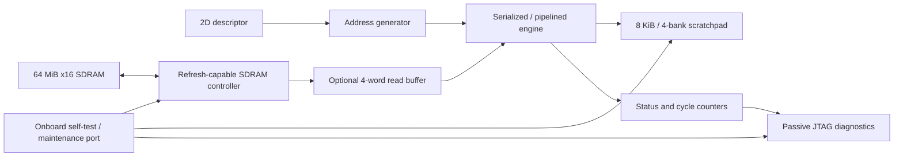

# Tensor Memory Accelerator

[](https://github.com/felixchen2007/tensor-memory-accelerator/actions/workflows/checks.yml)

**SystemVerilog tensor data movement on a Terasic DE10-Lite / MAX 10 FPGA.**
Descriptor-driven 16-bit copies and transposes from external SDRAM into a banked
scratchpad, with a preserved serialized baseline, pipelined transfers, and
four-word burst read prefetch.

**Measured on hardware: 2.88× cycle speedup for a 32×32 transpose**, from
16,525 to 5,735 cycles at nominal 50 MHz. Three implementations each passed two
fresh FPGA configurations and complete tile readback. Native UVM verification
passed 368 descriptors across eight configurations and detected injected data
corruption. A separate mutation campaign detected **21/21 selected RTL defects**
with clean nominal controls. [Results and evidence](docs/results.md) · [Reproduce](docs/reproduce.md)

**C++17 / DPI-C verification:** an independent golden model now runs alongside
the preserved SV scoreboard on XSim and Questa. It agrees with Python on
**387 complete transfer cases**. All eight XSim configurations passed dual
checking; three additional seeds executed constrained randomization and the
defined descriptor covergroup in one configuration.
[Architecture and build instructions](docs/cpp_reference.md) ·
[Measured performance](docs/reference_performance.md).

For a 32x32 prediction, C++ through DPI was about **31x faster than the SV
predictor** in the microbenchmark. The complete p1_b4_s0 RTL/UVM run showed **no speedup**:
11.30 s SV versus 11.75 s C++ median, with overlapping ranges. The report keeps
model computation, DPI overhead and complete simulation time separate.

## RTL mutation testing: 21/21 targeted faults detected

The verification environment is tested against **intentionally broken RTL**.
Each simulation compiles an isolated source copy with one controlled defect,
then requires a specific checker diagnosis. The accepted campaign detected all
21 selected defects: **20 through native UVM scoreboards/monitors and one through
the independent SDRAM pin model**.

| Fault family | Detected | Examples of injected defects |
| --- | ---: | --- |
| FIFO data and ordering | 5/5 | Corrupted payload/address, skipped or reused entry, write from an empty FIFO |
| Completion and bounds | 3/3 | Double-counted writes, completion before draining, disabled bounds check |
| Source/destination addressing | 4/4 | Wrong row/column stride in each address update |
| Burst read buffer | 5/5 | Wrong beat, missing bank/row tag bits, stale data after a write |
| Responses and refresh | 4/4 | Missing address error, dropped/changed held response, refresh starvation |

Unmodified controls passed **before and after** the campaign with zero UVM
warnings, errors or fatals. Compile failures, simulator crashes and unrelated
errors do not count as detections. Production source hashes remained unchanged.
The standard **eight-configuration UVM regression passed again** afterward.

This is a selected fault set in the pipelined / BL4 / linear configuration;
it measures checker sensitivity rather than exhaustive design coverage.
[Read the mutation report](docs/mutation.md) ·
[Inspect every exact edit and diagnosis](evidence/mutation/2026-10-29/results.json) ·
[Run the campaign](scripts/run_mutation_tests.py)

## Hardware result

Same 2 KiB tensor, data pattern, clock, destination layout, and refresh start
phase. Seeding, memory preflights, and final readback are outside the descriptor
counter. Recorded on **2026-10-29 UTC**.

| Implementation | Descriptor cycles | Latency at 50 MHz | Speedup vs baseline | Logic elements | Registers |
| --- | ---: | ---: | ---: | ---: | ---: |
| Serialized, single-word reads | 16,525 | 330.50 µs | 1.00× | 2,477 | 1,652 |
| Pipelined, single-word reads | 13,541 | 270.82 µs | 1.22× | 2,703 | 1,863 |
| Pipelined, four-word prefetch | **5,735** | **114.70 µs** | **2.88×** | 2,856 | 1,953 |

All fits use 65,536 RAM bits and one PLL. Counts include the complete board test
and diagnostics. The BL4 image's worst reported setup/hold slacks are
+1.584 / +0.147 ns under the documented external-delay assumptions.
[Six hardware runs and image hashes](evidence/hardware/2026-10-29/results.json).

This result covers one 2 KiB tile crossing a row boundary in SDRAM bank 1.
Sustained bandwidth, full-memory coverage, retention, and temperature/jitter
qualification remain open. Quartus warning 15064 for non-dedicated SDRAM clock
routing remains documented in [the hardware methodology](docs/hardware_benchmark.md).

## Implemented architecture



- **Addressing:** 32-bit byte addresses, 16-bit row/column counts and element
  data, independent source/destination byte strides, transpose and broadcast.
- **Pipeline:** separate ordered read/write channels and a four-entry FIFO;
  stable stalled requests, completion tracking, and error draining.
- **SDRAM:** project-authored IS42S16320F-7TL controller, initialization, refresh
  during held responses, closed rows, BL1 or BL4 reads, and single-word writes.
- **Scratchpad:** four inferred M9K banks, four read lanes, linear/XOR mapping,
  response backpressure and defined read/write collision behavior. The copy
  engine itself uses one 16-bit stream.
- **Diagnostics:** scratchpad/source preflights, full tile readback, stage/error
  records, passive read capture and versioned JTAG status decoding.

## Verification

The native **UVM 1.2** environment uses sequences, a sequencer/driver, passive
host and DMA monitors, an independent data/address/commit scoreboard, and a
scenario subscriber. It drives the real tensor-system RTL and an independent
SDRAM pin model through public maintenance/descriptor interfaces.

| Recorded check | Result |
| --- | --- |
| UVM configuration matrix | 2 engines × 2 read modes × 2 layouts; 368 descriptors |
| UVM data checks | 23,496 DMA reads, 23,496 DMA writes, 206,376 maintenance readbacks |
| UVM nominal severity counts | Zero warnings, errors, or fatals in every profile |
| Corruption control | Deliberately wrong SDRAM data detected by the scoreboard |
| RTL mutation campaign | 21/21 targeted defects detected; clean controls before/after; production sources unchanged |
| Focused simulation regression | 35 invocations, including 10 expected-failure controls |
| Python model/tooling tests | 61 tests passed |
| C++17 reference checks | 21 directed tests; 387 Python/C++ cases; 8,192 bank mappings; 100 C API lifecycles |
| Dual SV/C++ UVM | Eight XSim configurations; 368 descriptors; both paths detect corruption |
| C++-enabled mutation campaign | 21/21 selected faults: 17 C++ checks, 3 existing UVM protocol checks, 1 SDRAM pin check |
| Executed XSim full-feature runs | Three seeds, 138 descriptors; 100% of the defined descriptor covergroup in p1_b4_s0 |

The recorded Questa Starter license runs UVM base classes with seeded procedural
stimulus and explicit scenario counters. SV constrained randomization and
covergroups were compile-only on that license. Separate XSim 2025.2 runs now
execute those features in the scope listed above; earlier results retain their
original labels. See [UVM scope and reports](docs/uvm.md) and
[verification strategy](docs/verification.md). Hosted CI runs Python model and
evidence checks; RTL simulation and FPGA fitting run locally with vendor tools.
The [mutation report](docs/mutation.md) lists the faults, checker diagnoses,
reproduction commands and the limits of that selected fault set.

## Reproduce

Python 3.10+; no third-party Python packages are needed. From a fresh checkout:

```sh
python -m unittest discover -s tests -v
python scripts/check_portfolio.py
```

For Windows with Questa and Quartus Prime Lite installed:

```powershell
python scripts/run_uvm_tests.py
python scripts/run_mutation_tests.py
python scripts/run_cpp_reference.py
python scripts/run_dpi_uvm_tests.py --sim xsim --checker dual
python scripts/run_sdram_tests.py
python scripts/build_board.py --engine serialized
python scripts/build_board.py --engine pipelined
python scripts/build_board.py --engine pipelined --read-burst 4
```

These commands do not program a board. Tool setup, the full regression,
volatile hardware configuration, and offline replay are in
[the reproduction guide](docs/reproduce.md).

## Engineering tradeoffs

Burst prefetch amortizes ACTIVATE/PRECHARGE overhead across neighboring words.
It also regresses on sparse loads: the simulated column-gather case rises from
3,387 to 4,167 cycles while fetching four times as much data.
[Burst study](docs/bursts.md).

In the separate four-lane scratchpad study, XOR banking reduces a stride-32
column batch from four issue cycles to one; a stride-33 diagonal regresses from
one to four. This is distinct from the single-stream engine benchmark.
[Bank-layout study](docs/swizzle.md).

## Explore the project

| Path | Contents |
| --- | --- |
| [rtl/](rtl) | Address generator, two engines, scratchpads, SDRAM controller and board top |
| [tb/uvm/](tb/uvm) | Native UVM environment |
| [tb/](tb) | Directed benches, paired timing models and independent SDRAM model |
| [model/](model) and [tests/](tests) | Mathematical references, status decoders and Python tests |
| [quartus/](quartus) | MAX 10 synthesis, pin assignments, constraints and JTAG scripts |
| [scripts/](scripts) | Regressions, fitted builds, hardware benchmark and evidence checks |
| [evidence/](evidence) | Portable measured records, transcripts, source hashes and provenance |
| [Architecture](docs/architecture.md) | Descriptor/interface contract and design decisions |
| [Board debugging](docs/board_runs.md) | Failed read, diagnostic trace, working change and remaining limit |
| [Demo](docs/demo.md) | Repeatable demonstration and result interpretation |
| [Roadmap](docs/milestones.md) | Current release scope and optional extensions |

The memory-accelerator prototype is implemented. Runtime host control, a compute
consumer, automatic double buffering, SDRAM tensor writeback and open-row
scheduling are extensions. This independent educational design does not imply
compatibility with NVIDIA's Tensor Memory Accelerator. Vendor dependencies and
attribution are listed in [THIRD_PARTY.md](THIRD_PARTY.md).
