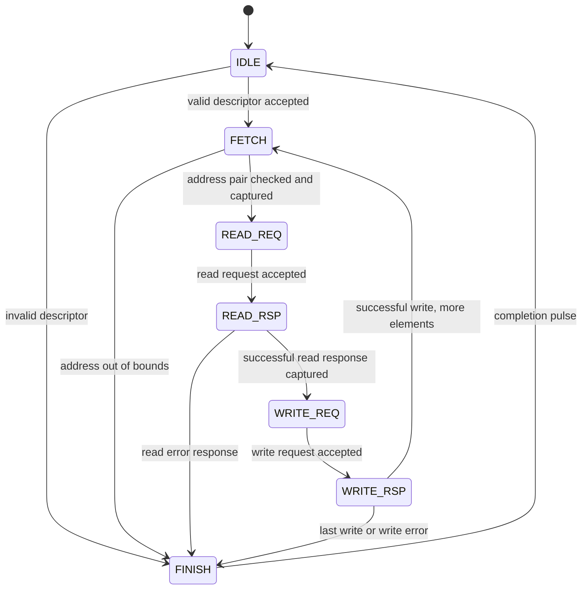

# Serialized data-transfer baseline

`rtl/tma_copy_engine.sv` connects the 2D address generator to independent source
and destination memory endpoints. It moves actual 16-bit data, including padded
copies, broadcasts using zero source strides, and transpose layouts using
destination strides. Both endpoints use byte addresses starting at zero.

This is the preserved stage 2 baseline. It has no bursts, overlapping requests,
SDRAM controller, or compute overlap. The separate [pipelined engine](pipeline.md)
implements read/write overlap and is selected through the same
[banked scratchpad integration](scratchpad.md).

## Transfer sequence



Wait states hold until the corresponding handshake. At most one memory
transaction is outstanding across the two endpoints. Each word is read and its
write is acknowledged before the next word starts. The next address generator
output can already be waiting while the current word is transferred.

## Descriptor and address rules

The descriptor ports match `tma_addr_gen`; see [architecture](architecture.md)
for their field definitions. The descriptor is accepted on `desc_valid &&
desc_ready`. `busy` remains high until completion, and conflicting input changes
while busy have no effect.

- Defaults: `ADDR_W=32`, `COUNT_W=16`, `SRC_BYTES=DST_BYTES=8192`.
- This engine transfers only 16-bit words. Bases and all strides must be even,
  including strides unused by a one-row or one-column descriptor.
- All base and stride fields must be at most the associated endpoint size minus
  two. A stride exceeding this limit is rejected even if an axis has count one.
- Every generated source/destination pair is checked against endpoint bounds
  before either memory request for that element is issued.
- Endpoint sizes must be even, at least two, and no greater than
  `2**(ADDR_W-1)`; `ADDR_W >= 2` and `COUNT_W >= 1` are required.
- These conservative stride bounds prevent unsigned address wrapping before an
  out-of-range pair can be detected. They are stricter than the standalone
  generator's modulo-arithmetic contract.
- Source and destination are separate address spaces. Identical numeric
  addresses do not test in-place overlapping copies on a shared physical memory.
- Repeated destination addresses are allowed. Successful writes occur in
  descriptor order, so the last successful write to a location wins.

Initial validation priority is empty shape, alignment, then base/stride bounds.
The engine does not pre-scan the full shape. If a later address is out of range,
earlier successful writes remain in place. This is partial completion, not an
atomic operation.

## Memory endpoint contract

All channels use ready/valid handshakes on the rising edge of the core clock.
The sender holds valid and payload stable until acceptance. Responses may be
delayed arbitrarily; they must remain valid until accepted. A request may not be
accepted without eventually returning its response unless the shared reset
cancels it. This baseline has no timeout.

| Channel | Payload / semantics |
| --- | --- |
| `rd_req_valid/ready` | `rd_req_addr`: aligned source byte address |
| `rd_rsp_valid/ready` | `rd_rsp_data[15:0]`, `rd_rsp_error`: one response per read |
| `wr_req_valid/ready` | `wr_req_addr`, `wr_req_data[15:0]`: destination word write |
| `wr_rsp_valid/ready` | `wr_rsp_error`: one acknowledgement per write |

The engine accepts responses only after the corresponding request handshake.
A successful write response guarantees that the write is complete at the
adapter's defined visibility point. A failed write response may leave the
affected word unspecified; the adapter must document its behavior. The test
endpoint suppresses the failed write so that fault cases have deterministic
whole-memory expectations.

`rst` is synchronous, active high, and must also flush both memory endpoints.
Already completed writes are not rolled back. After reset, no responses from
the canceled operation may arrive. Independent endpoint resets would require
an additional drain/epoch protocol, which is outside this baseline.

## Completion and errors

`done` pulses for one cycle after the final write acknowledgement, or after a
detected failure. `error` pulses alongside it when the operation failed.
`error_code` and the counters remain available until reset or the next accepted
descriptor. A new descriptor may be accepted on the edge following completion.

| Code | Name | Meaning |
| --- | --- | --- |
| 0 | OK | All writes successfully acknowledged |
| 1 | EMPTY | Zero rows or columns |
| 2 | ALIGNMENT | Odd base or stride |
| 3 | BOUNDS | Base/stride rejected or generated pair exceeds an endpoint |
| 4 | READ_ERROR | Read response reported a failure; no write for that element |
| 5 | WRITE_ERROR | Write response reported a failure |

No further requests are issued after an error. The address generator is reset
internally before accepting another descriptor. The regression includes valid
descriptors after faults to check recovery.

## Counters and cycle baseline

- `completed_elements[31:0]`: successfully acknowledged word writes. A failed
  write does not increment it. A successful default-width descriptor's maximum
  element count fits this field; larger count-width configurations would need
  a wider completed-element counter.
- `elapsed_cycles[63:0]`: rising edges after descriptor acceptance through the
  completion edge, including the final FINISH cycle.
- `read_wait_cycles[63:0]`: cycles waiting for read-request acceptance or read
  response availability.
- `write_wait_cycles[63:0]`: analogous write stalls and response waits.

The 64-bit counters use modulo arithmetic; overflow is not signaled. Only the
default parameter configuration has been verified.

With always-ready requests and responses first available in the cycle following
request acceptance, the successful operation cost is:

```text
elapsed_cycles = 5 * element_count + 1
```

Each element uses FETCH, READ_REQ, READ_RSP, WRITE_REQ, and WRITE_RSP; one FINISH
cycle completes the descriptor. For successful operations with delayed endpoints,
the extra cycles are the read and write waits.

The current 32x32 copy moves 2,048 payload bytes in 5,121 cycles in that minimum
latency model. This is approximately 0.400 payload bytes per core cycle. The
number exposes the serialization cost we can optimize. It is not SDRAM
bandwidth, a hardware clock result, or a speedup measurement.

## Verification and reproduction

The Python oracle generates the complete expected destination image and ordered
read/write traces. The RTL bench checks every request, all destination words,
status/counts, request stability under stalls, and counter values. It models
separate 8 KiB endpoints, request stalls, 0-7 extra response-delay cycles, and
injected read/write errors at selected elements.

Reset is tested during address fetch, a stalled read request, a delayed read
response, a stalled write request, a delayed write response, and the final
completion stage. The memory models flush pending responses on the shared reset.

```powershell
python scripts/run_tests.py
quartus_sh -t quartus/synth.tcl tma_copy_engine
```

Per-case measurements are written to `build/sim/copy_metrics.csv` and
`copy_metrics.json`; expectations and names are in `copy_manifest.json`.
See [results](results.md) for the executed run.
