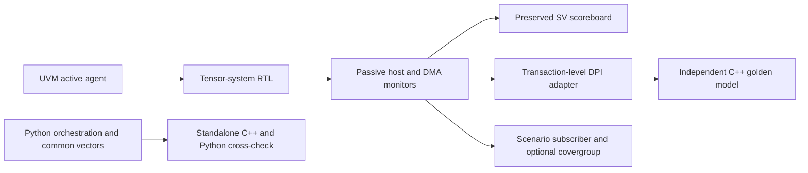

# C++17 reference model and native UVM DPI-C checking

The C++ model adds a second architectural oracle to the existing verification
environment. Production RTL, the original SystemVerilog scoreboard, Python
models, board fits and earlier published evidence retain their original bytes.
Python continues to own builds, vector generation, regression execution and
reporting.



## Architectural contract

[`reference/tma_reference.cpp`](../reference/tma_reference.cpp) calculates
addresses directly from row/column coordinates using 64-bit intermediate
arithmetic. It does not reproduce a hardware FSM, FIFO or incremental address
generator. Source and destination memories are distinct, with 16-bit values
and unsigned byte addresses/strides.

Validation priority matches the existing copy contract: empty shape (status 1),
alignment of all address/stride fields including unused strides (2), initial
bounds (3), then the legal row-major prefix. Later bounds failures preserve
committed earlier writes. Repeated destination addresses commit in order, so
the last successful write wins. A separate standalone copy API supports the
existing synthetic read/write-fault indices (statuses 4/5); a failed write is
left unchanged by that synthetic endpoint convention. The physical SDRAM UVM
environment has no ECC/error-return injection, and retains status 0..3 scope.

The standalone public copy API materializes complete read/write traces and a
complete destination image, matching Python's `copy_tensor`. Bank mapping is
checked separately against Python's linear/XOR model. The DPI path uses sparse
memories initialized only from passively observed, acknowledged maintenance
writes. Its ledger checks each accepted DMA request, response, write commit and
completion against the mathematical prediction. It has no RTL memory backdoor
and receives no driver-calculated expected data.

Allocations are bounded: at most 1,048,576 predicted beats and initialized words
per memory, and capacities of 2 bytes through 64 MiB. Limits are API/resource
errors, not fabricated hardware status codes. The UVM configuration uses the
real 64 MiB source and 8 KiB destination capacities. Larger standalone benchmark
endpoints are explicitly synthetic model scaling.

## DPI boundary and ownership

[`reference/tma_dpi.cpp`](../reference/tma_dpi.cpp) exports a plain C ABI:

| Operation | Boundary behavior |
| --- | --- |
| Create/destroy/reset | Opaque model handle; caller releases each live handle once and never reuses a destroyed handle |
| Seed/read memory | Scalar endpoint, byte address and 16-bit value in 32-bit unsigned containers |
| Submit descriptor | Eight unsigned fields; one prediction call per descriptor |
| Expected beat | Scalar output arguments; no C++ object or vector storage escapes |
| Observe transaction | Accepted read/write request/response or completion, not a call every clock cycle |
| Error/metrics | Explicit return codes, copied diagnostic strings, native execution/call counts and process peak working set |

The creating library owns all C++ allocations through destruction. Exceptions
are contained inside the API. String storage belongs to the model until the
next API operation; SV copies it during the call. Handles are single-threaded
simulation objects, not a concurrent host API. Reset clears reference state;
it does not establish support for arbitrary warm reset in the FPGA design.

SV `int unsigned` / `longint unsigned` map to 32-bit / 64-bit scalar C types.
The adapter explicitly checks X/Z before converting DMA observations to these
two-state types; maintenance readback comparisons retain four-state SV data.
This prevents an unknown value from silently becoming a valid integer.

## Configurable independent checking

[`tb/uvm/tma_dpi_pkg.sv`](../tb/uvm/tma_dpi_pkg.sv) adds a factory-selected
adapter without editing the existing UVM package:

- `sv`: original SV scoreboard and its original mathematical prediction.
- `cpp`: C++ owns expected data, addresses, ordering and committed memory; the
  original scoreboard's observation port is unconnected. Existing passive
  protocol monitors and scenario subscriber remain active.
- `dual`: the same observed transactions feed both independent scoreboards.

The C++ adapter reuses the original acceptance counters and planned-descriptor
gate. Corruption controls require the designated checker; dual mode requires
both independent data diagnoses. Mutation acceptance uses `cpp` mode so an SV
scoreboard failure cannot mask a missing C++ detection. Compile, loader,
license and simulator failures do not count as caught functional defects.

## Windows simulator compatibility

The minimal [`DPI proof`](../tb/dpi/tb_tma_dpi_smoke.sv) is itself a native UVM
test. It checks high-bit 32-bit inputs, a 64-bit unsigned wrap result and an
output pointer before the model is integrated.

- **Questa Intel Starter 2024.3:** direct loading of a separately built C++17
  DLL, alongside the simulator's UVM 1.2 DPI library. Its observed `svverification`
  license restriction remains specific to constrained randomization/covergroups.
- **Vivado XSim 2025.2:** Windows `xelab -sv_lib` expects a native archive. Its
  bundled GCC 6.2 frontend is older than the model's C++17 build. A small,
  generated GCC 6 C bridge archive forwards only C-compatible functions to the
  separately compiled C++17 DLL. STL objects/exceptions never cross that boundary.
  Each simulator gets its own build and ABI test.

The tested host compiler is MinGW-w64 GCC 15.1.0. C++ runtime and libgcc code are
statically linked into the model DLL; its compiler's remaining runtime DLLs
must be available. Python uses a scoped DLL search directory. XSim child
processes put Vivado's matching SJLJ runtime first on PATH to avoid loading an
unrelated `libstdc++-6.dll`. Host PATH is not modified globally. Windows argument
files preserve `=` in generics and plusargs through AMD's batch launchers.

Tool installations are discovered or selected using `TMA_CXX` and `VIVADO_BIN`.
No vendor source, compiler runtime or generated binary is redistributed.
AMD documents the [DPI linkage switches](https://docs.amd.com/r/2025.2-English/ug900-vivado-logic-simulation/xelab-xvhdl-and-xvlog-xsim-Command-Options).

## Reproduce

```powershell
# Standalone unit tests, Python/C++ agreement, C API lifecycles and model timings
python scripts/run_cpp_reference.py
# Minimal native UVM ABI probe on each simulator
python scripts/run_dpi_smoke.py
# Existing eight configurations with independent SV and C++ checking
python scripts/run_dpi_uvm_tests.py --sim xsim --checker dual
# C++-only functional checking, existing monitors and full RTL mutation catalog
python scripts/run_dpi_uvm_tests.py --sim xsim --checker cpp --profile p1_b4_s0 --mutations
# Multiple stimulus seeds
python scripts/run_dpi_uvm_tests.py --sim xsim --checker cpp --profile p1_b4_s0 --seed 20261029 --seed 57 --seed 991
# Execute the existing constrained-random/covergroup branch on XSim
python scripts/run_xsim_full.py --checker dual --profile p1_b4_s0 --full
# Same DPI adapter on Questa, procedural stimulus under Starter
python scripts/run_dpi_uvm_tests.py --sim questa --checker dual --profile p1_b4_s0
# Matched prediction-only timings and DPI dispatch overhead
python scripts/run_reference_bench.py --sim xsim
# Interleaved end-to-end checker comparison; compilation excluded from samples
python scripts/run_dpi_uvm_tests.py --sim xsim --profile p1_b4_s0 --compare --repeat 3
```

The original `python scripts/run_uvm_tests.py` command remains unchanged.
`build/cpp_reference/` holds timestamped results, source/library hashes, compile
reports and simulation logs. The common vector file plus native JSONL results
provide a file-based checking path even without a simulator or DPI support.
Native C++ unit/cross-model checks also run in hosted CI; hosted CI does not
claim a simulator run.

The full-mode launcher verifies that Windows' short path refers to the same
checkout. It works around Vivado's handling of coverage-directory paths with
spaces and records its own source hash. It does not change any model or checker.
If short filenames are disabled, use a checkout path without spaces for coverage.

## Performance methodology

The original Python public copy API is measured before architectural changes.
Its comparison with the standalone C++ copy API includes equivalent input-value
validation, full trace materialization and destination copying. Three warmups
precede seven timed repetitions; memory initialization, compilation and process
launch are outside pure-model samples. Small tensors still validate full
endpoint arrays, so input-validation cost is visible in those results.

A second microbenchmark measures complete ordered `(source,destination,data)`
prediction tables with Python, native C++, C++ through DPI, and the unchanged
SV scoreboard's `predict` function. No backend copies the full destination in
this microbenchmark. All predicted beats are compared outside timing. A separate
million-call loop estimates DPI dispatch cost against the same inline SV body;
it is not treated as useful tensor throughput.

End-to-end comparisons interleave `sv`, `cpp` and `dual` RTL simulations for the
same configuration, stimulus seed and workload. Reported wall time includes
simulator startup and actual RTL/agent work, while excluding compilation.
Prediction time, native API time and call count are reported separately.
Process peak working set includes runtime/code and is not per-model allocation;
Python traced allocation is a different metric. Repeated min/median/max values
retain variation on a shared workstation. A fast standalone model does not by
itself establish an end-to-end simulation speedup.
