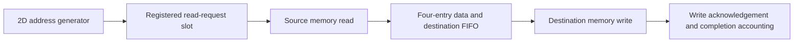

# Pipelined transfer engine and controlled comparison

`tma_copy_engine_pipelined.sv` is a separate implementation. The original
`tma_copy_engine.sv` remains the serialized reference. Both accept the same 2D
descriptors, transfer 16-bit words, use separate source/destination address
spaces, and report completion after memory acknowledgements.

## Structure



The engine can have one read and one write outstanding concurrently, plus data
waiting in the FIFO and one prepared read request. Read metadata preserves the
destination address associated with the returning word. The FIFO preserves
descriptor order. Writes remain ordered, and only successful write responses
increment `completed_elements`.

A channel can accept its next request on the same edge that it accepts the
previous response. When both endpoints support this behavior, request/data
stages can run every clock after filling. FIFO fullness backpressures the read
response; it never overwrites unread data. A held request retains its address,
data, and valid until accepted.

Defaults match the baseline: 32-bit byte addresses, 16-bit row/column counts,
8 KiB endpoint windows, and even bases/strides. Descriptor validation priorities
and per-element bounds checks are unchanged. The new `FIFO_DEPTH` parameter must
be a power of two and at least two; only the default four-entry configuration is
currently verified.

## Cycle model

For a nonempty successful transfer of N elements, with always-ready requests and
responses first available the cycle after acceptance:

```text
serialized elapsed cycles = 5*N + 1
pipelined elapsed cycles  = N + 6
```

The new overhead includes preparing the first read, passing data through the
FIFO, acknowledging the last write, checking the pipeline is drained, and the
completion stage. A single word takes seven cycles versus six in the baseline;
larger tiles amortize the startup/drain cost.

`read_wait_cycles` and `write_wait_cycles` retain their interface-based
definitions, but can count the same clock because channels overlap. Do not sum
them to reconstruct elapsed time. The new `buffer_stall_cycles` counts cycles
with a pending valid read response blocked by lack of FIFO capacity.
`peak_buffered` records the maximum FIFO occupancy and has
`$clog2(FIFO_DEPTH+1)` bits. Counters reset on a new descriptor and retain their
values afterward; cycle counters are 64-bit modulo counters as in the baseline.

## Error behavior and draining

Error codes match the baseline: empty, alignment, bounds, read response, and write
response failures. Completed transfers remain in place; execution is not atomic.

Prefetch means an error can occur after later reads have already been prepared
or offered to memory. Those reads may still be accepted and returned. The
pipeline does not withdraw an asserted request to make an error finish sooner.
This interface has no cancellation or timeout; memory must eventually accept
offered requests and return responses, or a shared reset must cancel them.

- **Bounds failure:** stop allocating new addresses, finish earlier legal reads,
  and write their data before reporting the failure.
- **Read failure:** preserve and finish writes from earlier successful reads.
  Stop allocating new reads and discard later prefetched responses after
  safely draining requests already prepared/offered.
- **Write failure:** prevent the next write from issuing on the failed response
  edge, discard queued later writes, and drain read activity without writing it.
- A write is not issued past an unacknowledged prior write unless that prior
  response is successful on the same edge. This preserves the same written
  prefix as the serialized functional oracle under the test endpoint contract.
- If multiple failure conditions arise through prefetch, earlier write errors
  take priority over later read errors, which take priority over still-later
  bounds errors.

The test endpoint suppresses a failed write, giving deterministic expected RAM
contents. Actual adapters may leave the failed word unspecified, as described
in [the memory contract](copy_engine.md). Prefetch is appropriate for ordinary
memory in the configured windows; side-effecting reads/MMIO are outside scope.
Source/destination physical aliasing is also outside the current contract.

Completion waits for the address stream to stop, the prepared read slot to be
empty, both response channels to drain, and the FIFO to empty. Reset clears all
pipeline/queue state and must flush endpoints; already committed memory writes
are not rolled back.

## Selecting an engine

`tma_copy_engine_select.sv` selects the core at elaboration time.
`tma_local_copy_system` has `PIPELINED=0` by default, preserving the baseline.
With `PIPELINED=1`, the same maintenance port and the same two banked scratchpads
connect to the new engine. This selection does not alter bank mapping or memory
port width. Four-lane memory traffic is a separate feature; this pipeline uses
one 16-bit read stream and one 16-bit write stream.

## Comparison methodology

The paired bench launches both engines together with identical tensor values,
shapes, addresses, and fault positions. Each engine has an independent instance
of the same behavioral memory model. Request-acceptance gaps and response delays
are functions of the transaction index, channel, case index, and recorded seed.
Thus corresponding requests receive the same service costs even when issued
at different times. A global cycle-driven random stream would not provide that
same transaction-by-transaction comparison.

The independent Python oracle supplies the entire expected destination image
and ordered write addresses/data. Prefetched reads can exceed the serialized
read count on fault cases, but must follow the legal source-address prefix and
must not produce additional writes. All destination words are checked for both
engines, including untouched locations. Error-case elapsed ratios are not
reported as performance speedups.

The suite adds 8x8, 16x16, 8x32, and 32x8 minimum-latency copies, a 32x32
minimum-latency transpose, a read fault with a stalled write/full FIFO, and a write
fault while another read request is stalled. Reset tests cover a stalled read
request, pending read response, full FIFO with blocked response, and outstanding
write acknowledgement. Request stability, counters, drain-before-completion,
FIFO capacity, and all six completion/error codes are checked.

## Reproduction

```powershell
python scripts/run_tests.py
quartus_sh -t quartus/synth.tcl tma_copy_engine_pipelined
quartus_sh -t quartus/synth.tcl tma_local_copy_system
quartus_sh -t quartus/synth.tcl tma_local_copy_pipelined
```

`--pipeline-only` runs the paired suite during focused debugging and writes
`pipeline_only_results.json`; it does not establish a full-regression pass.
The full runner additionally tests both engine configurations through the actual
scratchpad RTL, alongside all older suites. It exports `pipeline_metrics.csv`,
`pipeline_metrics.json`, and `pipeline_comparison.md` in `build/sim/`.

Reported speedups are cycle-count comparisons against this project's serialized
baseline under the specified memory model. They are not measured board
bandwidth or comparisons against optimized commercial DMA. Fitted clock frequency
and a shared external SDRAM bus may change end-to-end performance.
