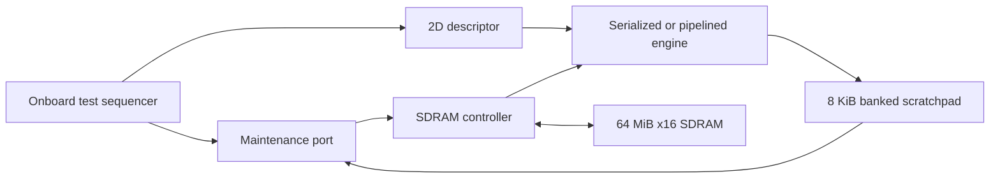

# SDRAM bring-up and tensor loading

The external source path is implemented and simulated: 64 MiB SDRAM -> selectable
copy engine -> 8 KiB banked scratchpad. The physical chip was identified as
**ISSI IS42S16320F-7TL** on 2026-10-27. The first physical run on 2026-10-28
configured successfully but reported **FAIL** on the LEDs. After independent
preflights and clock-forwarding comparisons, the project passed two fresh FPGA
configurations on **2026-10-29 UTC**. Each checked 1,024 scratchpad words, 1,024
SDRAM source words, and all 1,024 transposed destination words. The working
profile uses direct PLL forwarding; the electrical cause of the earlier DDR
forwarding failure remains unmeasured. [The hardware record](board_runs.md)
preserves the failed and passing images and observations.

This is a project-authored controller, independent of the Terasic example or a
third-party controller. BL1 retains the closed-page baseline. Optional BL4 reads
fill an eight-byte buffer while writes remain single-word. On 2026-10-29 UTC,
each of three profiles passed twice: 16,525 cycles serialized, 13,541 pipelined,
and 5,735 pipelined with BL4 prefetch. The last gives 2.88x over the baseline for
the same tile. See [the hardware comparison](hardware_benchmark.md) and
[burst contract and regressions](bursts.md). Open rows and write bursts remain planned.



## Memory geometry and addresses

Four banks, 8,192 rows per bank, and 1,024 sixteen-bit words per row give
33,554,432 words / 67,108,864 bytes. Both request channels use 32-bit **byte**
addresses. Valid word starts are `0x00000000` through `0x03fffffe`, inclusive.

| Byte-address bits | Meaning |
| --- | --- |
| 0 | Must be zero: sixteen-bit alignment |
| 10:1 | Column 0-1023 |
| 23:11 | Row 0-8191 |
| 25:24 | Physical SDRAM bank 0-3 |
| 31:26 | Must be zero: outside this device |

During READ/WRITE, A10 is zero because the controller explicitly precharges.
During PRECHARGE ALL, A10 is one. SDRAM banks and the scratchpad's four banks
are separate structures; changing the scratchpad swizzle does not change SDRAM
addressing.

## Controller contract

`rtl/tma_sdram_controller.sv` exposes the existing read-request/read-response and
write-request/write-response channels, with sixteen-bit data. A write response
is offered only after the WRITE command, recovery, PRECHARGE, and precharge
recovery. A read response is a registered snapshot and remains stable until
accepted. The controller has one transaction outstanding globally. When both
channels compete it alternates between them.

Odd or out-of-range addresses return an error, without ACTIVATE/READ/WRITE on the
SDRAM pins. Invalid reads return zero. Legal physical reads/writes have no error
reporting or ECC; data faults must be found by a readback test. Invalid writes do
not change memory. Initialization holds both request-ready signals low.

Refresh takes priority over a new request when due. The refresh timer and refresh
FSM continue while either response is held by backpressure. All rows have already
been closed before a response is offered, so an arbitrarily long held response
cannot keep a physical row open or stop refresh.

`rst` is the synchronous **cold-start** reset, shared with clients. Arbitrary warm
reset during an SDRAM transaction and data preservation across reinitialization
are not supported by this milestone. The board top has no button-reset input:
it waits for PLL lock and a startup counter, then runs once. Power cycle or
volatile reconfiguration reruns the test; the sequencer reseeds its source data.
Do not treat a scratchpad reset-persistence result as an SDRAM reset guarantee.

## Clocking and timing choices

The controller operates at a fixed 50 MHz / 20 ns. Its parameters do not support
changing frequency without recalculating timing, refresh, and capture edges.

The board wrapper instantiates Altera `altpll` through the project-authored
`tma_board_clocks` wrapper. Output 0 supplies the 50 MHz core clock; output 1 has
a requested 5.0 ns / 90 degree phase shift. The second output directly forwards
to `DRAM_CLK`. A continuously clocked fabric input register captures DQ;
the FSM takes that registered sample on the next core cycle. This is the exact
profile exercised by the two passing board configurations.
Commands, addresses, DQM, and output enable launch through a common registered
output stage; read capture accounts for this extra cycle. This keeps the DQ
input path free of the response-selection logic. Vendor primitives require the
Quartus libraries; no vendor source has been copied into the repository.

The initial direct-clock build missed the input setup requirement. The final
clock/input-register implementation must pass actual fitted setup and hold
checks; simulation alone is not accepted as timing evidence.

| Requirement / choice | Value |
| --- | --- |
| Startup wait | 10,000 cycles / 200 us after reset release |
| Startup commands | PRECHARGE ALL, eight AUTO REFRESH commands, LOAD MODE REGISTER |
| Mode register | `0x030` BL1 or `0x232` BL4 reads/single writes; sequential CL3 |
| ACTIVATE to column command | 3 clocks / 60 ns |
| WRITE to PRECHARGE | 3 clocks / 60 ns |
| READ to PRECHARGE | 5 clocks BL1 / 8 clocks BL4, after capture |
| PRECHARGE recovery | At least 4 clocks / 80 ns before another ACTIVATE |
| Refresh recovery | 6 clocks / 120 ns between refresh commands |
| Mode recovery | 3 clocks / 60 ns |
| Runtime refresh trigger | 350 core cycles / 7 us |
| Checker refresh deadline | At most 390 cycles / 7.8 us between runtime refresh commands |

These command spacings are intentionally conservative. The -7 datasheet requires
15 ns tRCD/tRP, 37 ns tRAS minimum, 60 ns refresh/row-cycle recovery, and 14 ns
write-to-precharge recovery. Mode recovery also respects the two-clock rule.
The 8,192 refreshes / 64 ms condition applies within the documented temperature
range; this build is not a qualification for an automotive temperature grade.

The SDC includes both input and output delays. DQ input maximum is 6.4 ns
(5.4 ns tAC plus two assumed 0.5 ns PCB legs); minimum is 2.7 ns
(2.5 ns tOH plus two assumed 0.1 ns legs). Output delays include setup/hold,
relative PCB skew, and margin. These PCB delay bounds are **assumptions**, not
measured board trace delays. The forwarded-clock constraint derives from the
actual PLL output pin and includes the output path. LED outputs are excluded
because they have no synchronous external receiver; SDRAM paths are constrained.

The fitted timing pass is conditional on those external-delay assumptions.
Quartus warning 15064 reports non-dedicated routing from PLL output 1 to the
SDRAM clock pin, whose jitter can depend on other switching activity. This
warning is retained. The observed board pass does not characterize that jitter;
clock-path measurement and broader stress tests remain needed. The board
revision has not yet been supplied.

The first passing smoke-test top used 2,644 LEs, 1,814 registers, 65,536 RAM bits and one PLL.
Worst fitted setup/hold slacks are +1.578 ns / +0.147 ns across the three corners.
Those initial runs report 13,545 descriptor cycles, or 270.9 us at the nominal
50 MHz clock. The newer aligned comparison and burst profile are recorded in
[the hardware benchmark](hardware_benchmark.md), including current fitted counts.

The initial programmed smoke-test top used 1,348 logic elements, 766 registers,
65,536 RAM bits (eight physical M9Ks), and one PLL. Worst reported setup slack is
1.011 ns and hold slack is 0.208 ns across the three reported operating corners.
The fixed test descriptor and unused telemetry are optimized in this top, so
these counts are not a generic-engine area comparison.

Warnings remain visible in the build evidence: unused vendor PLL phase-control
logic, intentional constant CKE/CS pins, the Lite LogicLock notice, the MAX 10
3.3 V interface notice, and empty dynamic-phase exceptions emitted by the vendor
PLL wrapper. The four STA messages concern nonexistent `phasedone_state` /
`internal_phasestep` registers, whose ports are disabled. The build script reviews
only those named vendor filter/exception pairs; it rejects other STA warnings.
No timing exception excludes SDRAM data or command paths.

## Tensor integration

`tma_sdram_copy_system` preserves the descriptor and maintenance interfaces of the
local system. `maint_req_dst=0` selects the SDRAM source, and `=1` selects the
scratchpad destination. Maintenance can read/write either endpoint while the
engine is idle. Descriptors wait for initialization and any maintenance response;
descriptors have priority over a simultaneous new maintenance request.

The copy selector now forwards `SRC_BYTES` / `DST_BYTES` parameters to either
engine. Defaults remain 8 KiB for all earlier tests; this system selects a
64 MiB source and 8 KiB destination. Neither copy-engine implementation changed.
Only SDRAM-to-scratchpad tensor loads are connected in this milestone. Tensor
writeback to SDRAM, write bursts, open-row hits, and multiple pending SDRAM requests
are future work. Maintenance writes are for seeding/tests, not a store engine.

## Verification and comparison

The project-authored pin-level model has no access to controller state. It
decodes commands/addresses at the SDRAM clock, stores data by physical bank/row/
column in a sparse array, and checks initialization, mode, tRCD, tRP, tRAS,
tRC, tRRD, write recovery, bus ownership, and refresh deadlines. It models CL3
data drive and release, including a configurable tAC. This is a subset model,
not an ISSI model or an electrical simulator.

Four controller runs cover normal and earliest modeled data availability,
the board's 5.0 ns clock phase, and a shorter refresh interval. Each checks
713 read responses, 688 physical writes, four invalid accesses, and 24 requests
with both channels competing. Stalls include a held read response and a held
write response lasting 850 cycles each. All 25 word-address bits, every bank,
row boundaries, the last word, walking ones/zeros, and 600 random addresses are
exercised. There is no claim to have exhaustively tested all 64 MiB.

Four deliberate failures must be detected: preventing runtime refresh must trip
the deadline checker, and shifting read data by one clock must trip the data
scoreboard. Clock phases with insufficient setup or hold must trip their respective
pin checks. Their fatal messages are expected evidence, not failing positive tests.

Twelve tensor cases run in all four engine/layout combinations. Every case
clears and checks all 4,096 destination words through the public maintenance
port: 49,152 destination comparisons per configuration, 196,608 overall. Cases
cover 32x32 copy/transpose, padded rows, column gathers, broadcast, row crossing,
all SDRAM banks, the final word, empty/alignment errors, and late bounds errors
with the legal write prefix preserved. Every descriptor starts at the same
refresh phase across runs, avoiding a timing bias from earlier host operations.

| Simulated workload | Serialized cycles | Pipelined cycles | Ratio |
| --- | --- | --- | --- |
| One word | 17 | 18 | 0.944x |
| 32x32 copy | 16,523 | 13,539 | 1.220x |
| 32x32 transpose | 16,523 | 13,539 | 1.220x |
| Padded 8x16 | 2,064 | 1,693 | 1.219x |
| 32x8 column gather | 4,130 | 3,387 | 1.219x |

These are complete descriptor times with the registered output stage, single-word SDRAM model and
refresh policy. They are not physical-board measurements. The earlier 4.97x
local-RAM result remains valid for its different memory conditions. Here the
SDRAM command/recovery overhead dominates, so overlap produces a smaller gain.
Linear and XOR scratchpad mapping give identical single-stream cycle counts.

## Reproduce

```powershell
python scripts/run_sdram_tests.py   # focused SDRAM subset
python scripts/run_tests.py         # all model and RTL suites
python scripts/build_board.py       # full fitter + timing + pin checks; no programming
```

Set `QUESTA_BIN` or `QUARTUS_BIN` to the tools' executable directory if discovery
does not find them. The SDRAM suite links the installed `altera_mf_ver` and
`fiftyfivenm_ver` libraries for the board's PLL and diagnostic probe simulation. The
other memory model and controller tests remain project RTL. Python needs only
the standard library; downloaded reference PDFs are not runtime dependencies.

`build/sim/results.json` records a full-suite pass and source hashes.
`build/sdram_sim/results.json` is a focused-suite record when that command is
run; an older record must be checked against its hashes. Comparison CSVs and
`sdram_comparison.md` are written beside the relevant simulation result.
`build/quartus/de10_lite/board_results.json` records the fitted build, all corner
slacks, pins, warnings, source hashes, and SOF hash. The build script rejects
negative timing or unresolved clock/constraint warnings even if Quartus returns
success. A fitted-build pass never records a hardware test as passed.

## Physical-board procedure

The image is `build/quartus/de10_lite/output_files/tma_de10_lite.sof`.
Use the USB-Blaster connector and confirm the JTAG chain reports the expected
MAX 10 device before loading this **volatile SOF**. The compiler also emits a
POF; this procedure does not use it or change nonvolatile configuration.

The autonomous sequence writes 1,024 distinct pattern values starting at byte
address `0x010007f0`, crosses an SDRAM row boundary, transposes the 32x32 tile
into the scratchpad, and reads/checks all 1,024 destination values. The format-2
diagnostic revision first writes/reads the 1,024-word scratchpad tile and then
directly reads back the 1,024 SDRAM source words before issuing the descriptor.
Separate stage bits and counts identify where a failure occurs. It then stops
the workload while the controller continues refreshing. It uses no host serial
connection and is not a full-memory diagnostic.

| LED | Meaning |
| --- | --- |
| LEDR0 | SDRAM initialization complete |
| LEDR1 | Test passed |
| LEDR2 | Test failed |
| LEDR3 | Test in progress |
| LEDR4 | Slow heartbeat |
| LEDR9:5 | Readback progress bits; use PASS/FAIL for final status |

Expected final state is LEDR0/1 on, LEDR2/3 off, with LEDR4 blinking. Capture that
result and repeat from reconfiguration/power cycle before claiming a board pass.
If it fails, retain the exact image/hash and inspect clock/data timing before
changing the memory scheduler. Wider hardware address tests, sustained retention,
temperature/voltage margins, and measured bandwidth remain subsequent checks.
Earlier format-2 images reported a first-word SDRAM failure; the direct-clock
image passes both preflights and the transpose in two configurations.
The passive probe can be decoded offline
with `python scripts/read_board_status.py --transcript path/to/probe.log`.
Hardware access requires explicit `--hardware` with the board connected.
See [the diagnostic layout and failure codes](diagnostics.md).

## Hardware references

- [Terasic resource page](https://www.terasic.com.tw/cgi-bin/page/archive.pl?Language=English&No=1021&PartNo=4), listing manual version 1.7.
- [Terasic manual download](https://www.terasic.com.tw/cgi-bin/page/archive_download.pl?Language=English&No=1021&FID=a13a2782811152b477e60203d34b1baa). The downloaded PDF has October 17, 2022 footers. Clock, LED, and SDRAM pins were checked against Tables 3-2, 3-5, and 3-12, printed pages 24, 27, and 38.
- [Terasic System CD download index](https://download.terasic.com/downloads/cd-rom/de10-lite/). The official SDRAM RTL example was downloaded for inspection and its SDRAM pin assignments match this project. Its controller source is kept only in the ignored reference folder and is not part of this project's RTL.
- [ISSI-authored IS42/45S16320F datasheet, Rev. B1, distributor mirror](https://www.mouser.com/datasheet/2/198/42-45R-S_86400F-16320F-706495.pdf), pages 1, 17-18, 20-21, 24-26. The ISSI-hosted download was blocked; the manufacturer's document was readable through this mirror. In particular, the CAS description distinguishes the drive edge `n+CL-1` from the following edge by which data is valid.

The SDRAM controller and pin-level model are project-authored. Clock-generation
primitives and their simulation models are supplied by Altera with Quartus.
