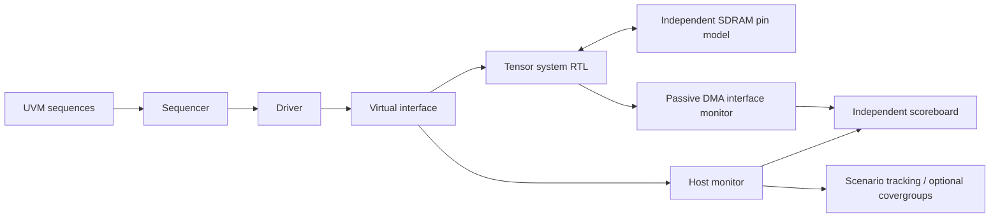

# Native UVM verification

The verification environment uses the native UVM 1.2
library supplied with Questa, compiled and linked to its native DPI library.
The UVM testbench drives `tma_sdram_copy_system`: both transfer engines, SDRAM
controller, optional burst buffer and banked scratchpad are real RTL.

## Environment



The active agent owns descriptor and maintenance transactions. Its driver uses
clocking blocks, holds requests until acceptance, applies response stalls, and
can offer a maintenance read during DMA to verify that it remains blocked until
completion. Factory registration, configuration DB, sequence items, phases,
objections and analysis ports are used directly from `uvm_pkg`.

Two passive monitors observe accepted host transactions and the engine's actual
read/write interfaces. They check request and response stability under stalls.
The scoreboard does not use driver-provided expected data, RTL address-generator
outputs, or hierarchical RAM-array access. It builds source and destination
shadow memories from observed, acknowledged maintenance writes. Independent
64-bit row/column arithmetic predicts each descriptor's legal prefix.

Every DMA read address/data, write address/data, write acknowledgement and final
status/count is checked. The destination model commits predicted data only on
write acknowledgement. Public maintenance readbacks check RAM contents as well.
Full 4,096-word scans run initially, after four large directed workloads, and
at the end; smaller cases read all written addresses plus guard words.

## Test plan

The default matrix runs serialized/pipelined x BL1/BL4 x linear/XOR layout: eight
profiles. Each cold-start simulation executes 34 directed descriptors and 12
seeded generated descriptors. Directed scenarios cover all four SDRAM banks
crossed with copy, transpose, padded, column and broadcast accesses, every burst
word offset, row/device boundaries, destination aliases, empty descriptors,
alignment (including unused strides), and bounds errors with a committed prefix.
An 850-cycle held SDRAM response exercises independent refresh service.

A separate corruption control XORs actual SDRAM read data in the pin model.
It must produce the scoreboard's `TMA_READ_DATA` UVM error and must never print
the pass marker. An arbitrary simulator error does not satisfy this control.

The scoreboard, protocol monitors and scenario tracker must report no UVM errors
or fatals in nominal runs. Required scenario counters include all 20 bank/family
combinations, four offsets, status codes 0–3, five size categories, response
stall categories, busy-time maintenance blocking and the long hold. These are
specific exercised scenarios, not proof of complete design coverage.

Response-error injection for engine status codes 4/5 remains in the older
behavioral endpoint benches. The current UVM SDRAM environment checks valid
physical reads, data corruption and descriptor errors; the SDRAM interface has
no physical ECC/error-return mechanism. Arbitrary warm reset is unsupported.

## Installed-license boundary

The installed Questa Intel Starter 2024.3 successfully executes UVM base classes,
sequences, drivers, monitors and scoreboards. A direct capability test reported
`Failure to checkout svverification license feature` for a covergroup. The
optional licensed branch compiles; its execution is not claimed on this license.

Default Starter mode uses a replayable bounded xorshift PRNG rather than the
SystemVerilog constraint solver. Its UVM subscriber records procedural scenario
counters rather than covergroups. Result JSON explicitly records
`sv_constrained_randomization_executed=false` and `sv_covergroups_executed=false`.
This is native UVM with a documented simulator feature limit.

`--full` compiles the descriptor constraints and a functional covergroup with
bank/family cross coverage. It requires a simulator license permitting those
features. It fails if that license is absent; the runner never silently switches
modes or calls compile-only output a test pass. A university license server or
licensed lab workstation may provide access; no purchase is required to use the
current UVM base-class environment.

## Executed acceptance result

On **2026-10-29 UTC**, the standard SDRAM regression passed all eight UVM
profiles with seed `20261029`: 46 descriptors per profile, **368 total**.
Each profile reported zero UVM warnings, errors and fatals, all 20 required
bank/family combinations, and all required offset/status/size/stall scenarios.
Across the matrix the independent scoreboard checked **23,496 DMA reads**,
**23,496 DMA writes**, and **206,376 maintenance readbacks**. These are counts
of checked transactions, including repeated addresses, rather than unique
memory locations or a coverage percentage.

The ninth UVM simulation deliberately corrupted SDRAM read data. The scoreboard
reported `TMA_READ_DATA` at address zero (`a55b` instead of `a55a`), and the test
did not print a pass marker. This demonstrates that the data checker detects
the injected fault. The combined focused regression also passed its 26 existing
directed simulations and fault controls: **35 invocations total**.

The [machine-readable UVM result](../evidence/uvm/2026-10-29/results.json)
records the executed matrix and source hashes; adjacent transcripts retain the
topology, scenario report and severity counts. This run used Starter mode.
The optional `--full` branch compiled with zero errors and warnings, but its
constraint solver and covergroups were **not executed**. The older full-project
regression remains a separate historical record.

## Reproduce

```powershell
python scripts/run_uvm_tests.py
python scripts/run_uvm_tests.py --profile p1_b4_s0 --seed 20261029 --random-cases 12
python scripts/run_uvm_tests.py --full --compile-only
# With the required SV verification license:
python scripts/run_uvm_tests.py --full
```

Set `QUESTA_BIN` when discovery does not find the installed simulator. This
runner currently targets the Windows Questa layout with UVM 1.2 sources and
`uvm_dpi.dll` alongside the simulator. Vendor library source is referenced from
the installation rather than copied into the project.

`build/uvm/starter/results.json` records standalone runs. The standard SDRAM
runner also runs UVM and places its record in
`build/sdram_sim/uvm/starter/results.json`; the full regression uses
`build/sim/uvm/starter/results.json`. Each keeps seeds, configuration, mode,
source hashes, topology and raw UVM reports. Earlier directed/hardware results
remain distinct. UVM runs in simulation; the FPGA's RTL self-test, fitted timing
checks and JTAG readout remain necessary for physical validation.
